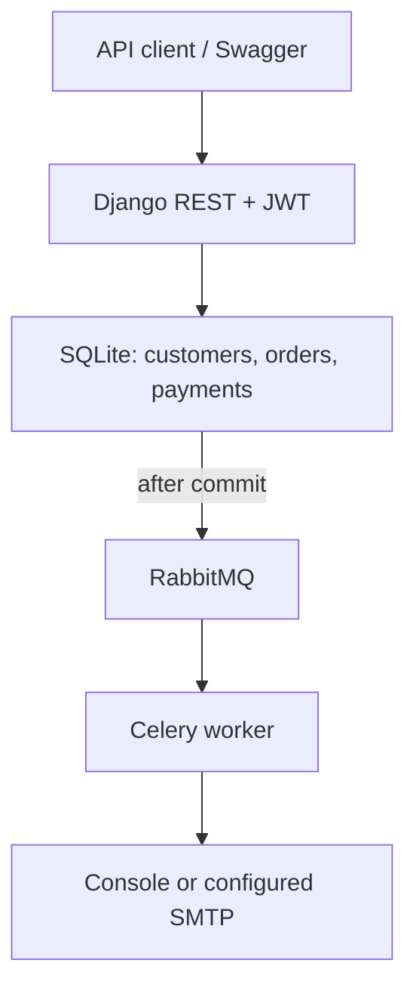

# Orders and Payments API

**Manage customers, product orders, payment records, and price-drop notifications through a Django REST API.**

This portfolio application connects a small sales workflow: create a customer and products, place an order, record its payment status, and export an order report. A Celery task notifies previous buyers when a product price decreases.

**Python · Django · Django REST Framework · JWT · Celery · RabbitMQ · SQLite**

> Development prototype. Payment records are internal bookkeeping; no bank, card processor, settlement, or refund integration is implemented. Only use synthetic customer data for evaluation.

## Product workflow

| Operation | Behavior | Source |
| --- | --- | --- |
| Customer/product management | Authenticated CRUD; model permissions control writes | [Viewsets](sistema_pagamentos/views.py) |
| Order creation | Creates the order and nested items atomically | [Serializers](sistema_pagamentos/serializer.py) |
| Order update | Supplied items replace the previous collection; omitted items stay unchanged on PATCH | [Serializers](sistema_pagamentos/serializer.py) |
| Payment recording | Accepts an order ID and a payment status | [Models](sistema_pagamentos/models.py) |
| Price decrease | Queues a notification after the database commit | [Product save hook](sistema_pagamentos/models.py) |
| Buyer notification | One email per distinct recipient per task execution | [Celery task](sistema_pagamentos/tasks.py) |
| PDF report | Staff-only report of a customer's orders | [Report view](sistema_pagamentos/views.py) |

## Architecture



RabbitMQ is the configured broker. Redis and SendGrid are not required by the current implementation. SQLite is the configured database; PostgreSQL is not configured by this README.

## Run locally

Use Python compatible with Django 5.1 (the requirements pin 5.1.7), Git, and RabbitMQ for asynchronous notifications. The requirements retain the repository's existing pinned versions; dependency upgrades are a separate task.

```bash
git clone https://github.com/joaovitormessias/sistema-pagamentos.git
cd sistema-pagamentos
python -m venv .venv
source .venv/bin/activate
python -m pip install -r requirements.txt
cp .env.example .env
```

Replace `SECRET_KEY` in `.env` with a locally generated random secret. The default email backend prints messages to the worker console, so no SMTP credentials are needed for a local review.

```bash
python manage.py migrate
python manage.py createsuperuser
python manage.py runserver
```

In separate terminals, start the broker and worker:

```bash
docker run --rm --name payments-rabbitmq -p 127.0.0.1:5672:5672 -p 127.0.0.1:15672:15672 rabbitmq:3.13-management
# Run from the repository root with the virtual environment active:
celery -A core worker --loglevel=info --pool=solo
```

Open [Swagger](http://localhost:8000/api/swagger/) or [Django admin](http://localhost:8000/admin/). Obtain a JWT with `POST /token/` and send `Authorization: Bearer <access-token>` on protected requests. A superuser is suitable for local evaluation; normal users need the corresponding Django model permissions for writes.

For SMTP, configure `EMAIL_BACKEND=django.core.mail.backends.smtp.EmailBackend`, `EMAIL_HOST`, `EMAIL_HOST_USER`, `EMAIL_HOST_PASSWORD`, `EMAIL_PORT`, `EMAIL_USE_TLS`, and `DEFAULT_FROM_EMAIL`. Do not commit credentials.

## Example evaluation

1. Create a Django user in admin, then create a customer through `POST /api/clientes/` with `user`, `nome_cliente`, and optional `cnpj`.
2. Create a product through `POST /api/produtos/` with `nome_produto`, `preco_unitario`, `quantidade`, and `descricao`.
3. Create an order using actual IDs returned above:

```json
{"cliente": 1, "itens": [{"produto": 1, "quantidade": 2}]}
```

Send it to `POST /api/pedidos/`. Record a payment with `POST /api/pagamentos/`:

```json
{"pedido": 1, "status_pagamento": "realizado"}
```

4. Lower the product price through PATCH and inspect the worker's console email.
5. As staff, request `GET /api/relatorio_pedidos/1/` for the customer report.

Status values are `naorealizado`, `realizado`, `emandamento`, and `recusado`. Domain field names remain Portuguese to match the API.

## Verification

```bash
python manage.py check
python manage.py test sistema_pagamentos
```

Eight regression tests exercise item replacement, omitted/empty items, invalid quantity, payment creation, deferred notifications, duplicate recipients, and report authorization. They passed in the review environment using Django 5.2.8; the complete pinned-dependency installation and external RabbitMQ/SMTP delivery were not exercised. Tests use an isolated database and mocked task dispatch/in-memory email.

## Design limits and next steps

- Order totals use **current product prices**, not a historical purchase-price snapshot. Orders do not reserve or decrement stock.
- Payment timestamps are record-creation timestamps; status changes do not prove money movement.
- After-commit dispatch prevents premature notification but is not a durable outbox. Broker failure after commit and duplicate task delivery need an explicit retry/idempotency design.
- API reads are authenticated but not scoped by customer ownership. This is an administrative prototype, not a multi-tenant customer portal.
- Add price snapshots, stock constraints, durable notifications, and deployment hardening before production use.

[MIT license](LICENSE) · [Maintainer](https://github.com/joaovitormessias)
